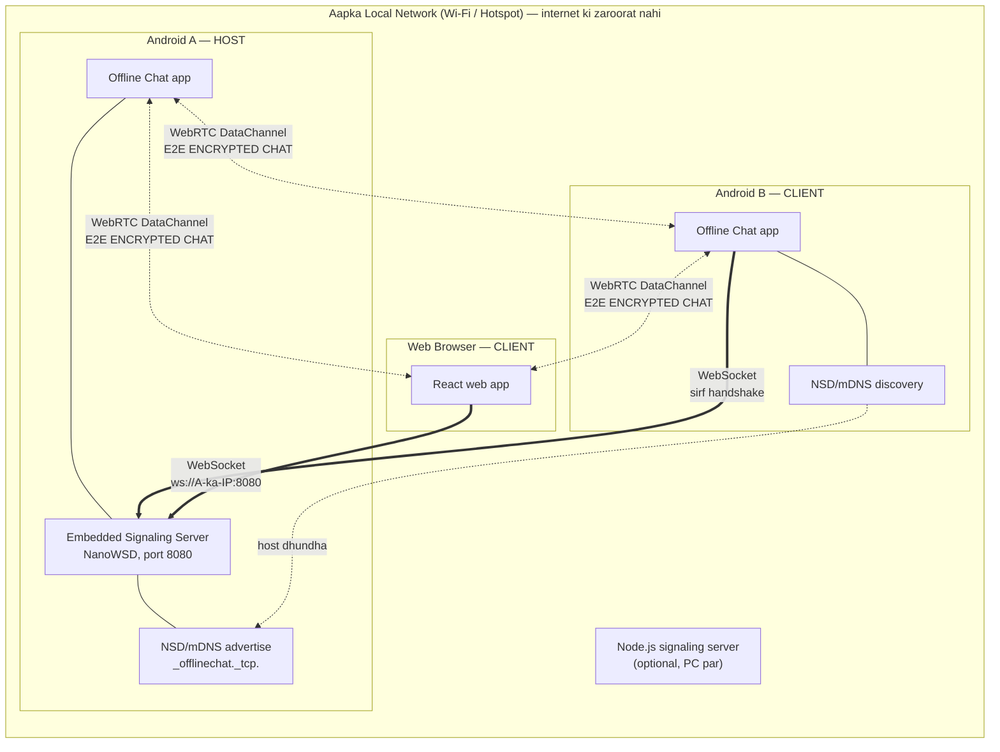
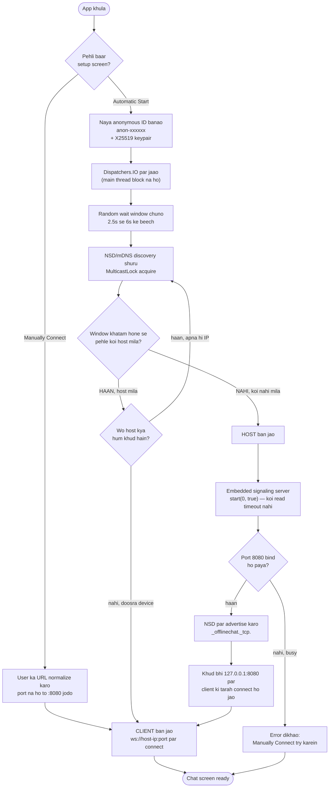
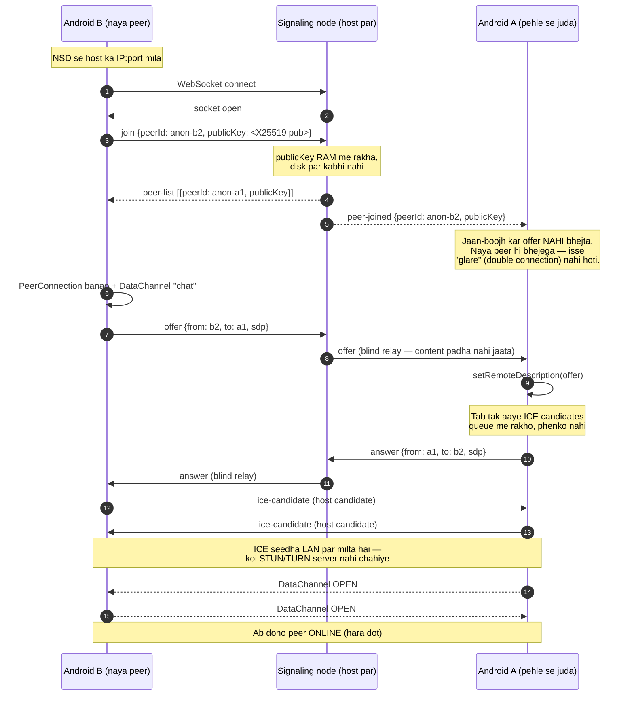
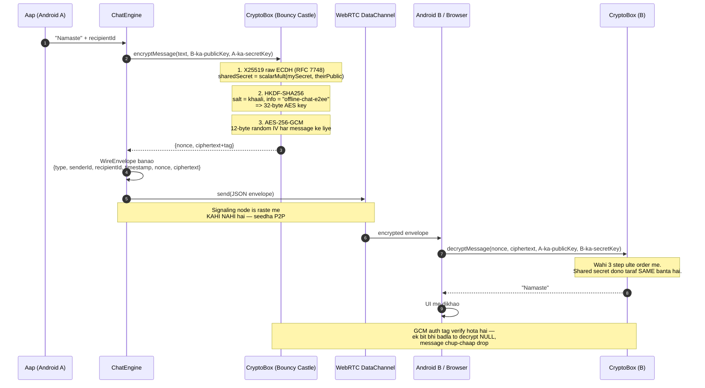
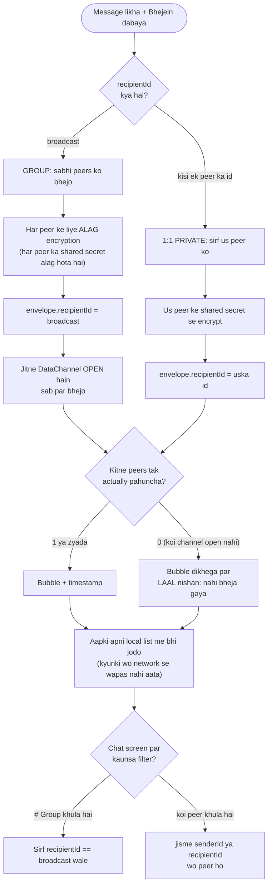
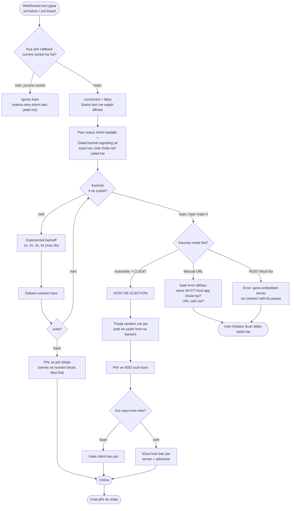
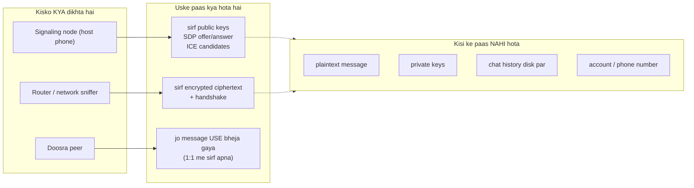
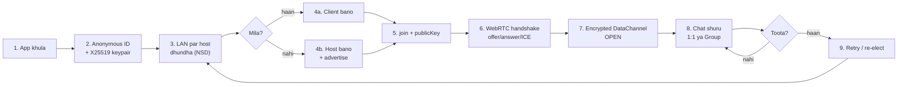

# Offline Chat — App kaise kaam karta hai (Flow Charts)

Poora system **Hinglish** me, diagrams ke saath. GitHub in diagrams ko apne aap render
kar deta hai (Mermaid). Har diagram ke neeche ek short explanation bhi hai.

> **Ek line me:** ek device *host* banta hai aur LAN par ek chhota signaling node chalata
> hai. Baaki devices use dhundh kar usse jud jaate hain. Signaling node sirf *parichay*
> (handshake) karwata hai — asli chat **seedha device-to-device, encrypted** jaata hai.

---

## 1. Poora architecture — kaun kya karta hai

**Samajhne wali baat:** moti (`==>`) line sirf handshake ke liye hai. Chat hamesha
dohri (`<-.->`) encrypted DataChannel par jaata hai — **host ke server se hokar nahi**.
Isliye host bhi aapka message padh nahi sakta.

Browser mDNS discover nahi kar sakta, isliye web app ko host ka IP **manually** daalna
padta hai (`ws://192.168.1.5:8080`). Android-to-Android apne aap discover ho jaata hai.

---

## 2. App khulte hi kya hota hai — role auto-detection

Yeh sabse important flow hai. App khud decide karta hai ki use **host** banna hai ya
**client**.

### Random wait window kyun? (yeh ek asli bug fix hai)

Pehle window **fixed 3 second** thi. Do phone ek saath kholiye to:

| Fixed 3s (purana) | Random 2.5–6s (naya) |
|---|---|
| Dono 3s scan karte hain | Ek ko chhoti window milti hai, ek ko badi |
| Koi advertise nahi kar raha, isliye dono ko kuch nahi milta | Chhoti window wala pehle **host** ban kar advertise shuru karta hai |
| **Dono host ban jaate hain** → do alag islands, kabhi nahi milte | Badi window wala abhi bhi scan kar raha hai → use host **mil jaata hai** |
| Recovery: app force-close karo | Recovery: kuch nahi karna, apne aap jud jaata hai |

**Host khud bhi `127.0.0.1` par client ki tarah connect kyun hota hai?** Taaki host aur
client dono ka chat-logic **bilkul same** rahe — ek hi code path, do tarah ke bugs nahi.

---

## 3. Do device ka milna — discovery + WebRTC handshake

### Yahan do cheezein dhyan dene layak hain

**1. Offer sirf ek taraf se.** Server naye peer ko `peer-list` bhejta hai aur purane
peers ko sirf `peer-joined`. Naya peer hi offer bhejta hai. Agar dono taraf se offer
jaata to do alag PeerConnection ban jaate ("glare") aur messages duplicate aate.

**2. ICE candidate queue.** `setRemoteDescription` **asynchronous** hai. Agar ICE
candidate usse pehle pahunch jaaye aur seedha `addIceCandidate` call ho to wo **reject**
ho jaata hai. LAN par STUN/TURN nahi hote, isliye sirf *host candidates* hi hote hain —
ek bhi candidate gira to DataChannel **kabhi open hi nahi hota**. Isliye candidates ko
queue karke `onSetSuccess` ke baad drain kiya jaata hai.

---

## 4. Message bhejna — end-to-end encryption ka poora safar

### Encryption kyun dono platform par ek jaisa kaam karta hai

| Step | Android | Web browser | Same kyun? |
|---|---|---|---|
| Key agreement | Bouncy Castle `X25519Agreement` | tweetnacl `scalarMult` | Dono **RFC 7748** implement karte hain |
| Key derivation | `HKDFBytesGenerator(SHA256)` | WebCrypto `HKDF` | Dono **RFC 5869**, same salt/info |
| Cipher | `Cipher("AES/GCM/NoPadding")` | WebCrypto `AES-GCM` | Dono **NIST SP 800-38D** |
| Info string | `"offline-chat-e2ee"` | `"offline-chat-e2ee"` | Hard-coded, dono jagah same |

Algorithm standardized hain, isliye library alag hone par bhi output **byte-for-byte**
same aata hai. Yeh cheez `scripts/android-interop-test.mjs` me RFC 7748 ke official
test-vector ke saath verify ki gayi hai.

---

## 5. Group chat vs 1:1 private chat

**Dhyan dein:** group me bhi message **ek saath sabko** nahi jaata — har peer ke liye
alag-alag encrypt hota hai, kyunki har peer ke saath shared secret alag hai. Iska matlab
group me bhi forward secrecy ka structure bana rehta hai: ek peer ki key leak hone se
baaki peers ke messages safe rehte hain.

**"nahi bheja gaya" wala laal nishan kyun zaroori hai?** Pehle message bubble hamesha
normal dikhta tha, chahe DataChannel band ho. User ko lagta tha message chala gaya — wo
dobara koshish hi nahi karta tha. Ab sach dikhta hai.

---

## 6. Connection tootne par kya hota hai — reconnect + host re-election

### Teen problem jo pehle thi, ab nahi

| Pehle | Ab |
|---|---|
| Connection tootta to app **hamesha ke liye atak** jaata | Automatic retry with backoff, phir host re-election |
| Har disconnect par ek hi message: *"Host start nahi ho paya"* — chahe aap client ho | Role ke hisaab se **sahi aur kaam ki** wajah |
| Host chala gaya to sabko app **restart** karna padta tha | Baaki devices apne aap naya host chun lete hain |

**"Phir se join bhejo" kyun zaroori hai?** Reconnect par server ka `peers` map humein
bhula chuka hota hai (socket close par entry hat jaati hai). Bina dobara `join` bheje
hum connected to dikhte, par kisi ki peer-list me **kabhi nahi aate** — yaani chat dead.

---

## 7. Security model — kisko kya pata chalta hai

| Cheez | Kahan hai | Kab tak |
|---|---|---|
| Private X25519 key | Sirf RAM, app ke andar | App band = khatam |
| Chat messages | Sirf RAM, dono devices par | App band = khatam |
| Public keys | Signaling node ki RAM me | Node band = khatam |
| Disk par | **Kuch nahi** | — |

**Imaandaari:** yeh app aapke **apne LAN ke andar** anonymous nahi hai — doosre peers
ko aapka session id (`anon-xxxxxx`) aur IP dikhta hai. Jo cheez chhupti hai wo message
ka **content** hai, aur wo bhi LAN ke bahar walon se.

---

## 8. Ek nazar me poora flow

---

## In diagrams ko dekhna kaise hai

- **GitHub par:** yeh file kholiye — Mermaid diagrams apne aap render ho jaayenge.
- **Locally:** VS Code me *Markdown Preview Mermaid Support* extension, ya
  <https://mermaid.live> par diagram ka code paste kar dijiye.
- **Share karne ke liye:** [`docs/flowchart.svg`](flowchart.svg) — poora flow ek image me,
  WhatsApp/Telegram par bhej sakte hain.

## Code se mapping

| Diagram | Code |
|---|---|
| 2 — role auto-detection | `chat/ChatEngine.kt` → `scanThenDecide()`, `becomeHost()` |
| 3 — handshake | `chat/ChatEngine.kt` → `handleSignal()`, `createConnection()` |
| 4 — encryption | `crypto/CryptoBox.kt` |
| 5 — group vs 1:1 | `chat/ChatEngine.kt` → `sendMessage()`, `ui/ChatScreen.kt` |
| 6 — reconnect | `chat/ChatEngine.kt` → `scheduleReconnect()` |
| Host ka server | `signaling/SignalingServer.kt` |
| NSD discovery | `discovery/NsdHelper.kt` |
